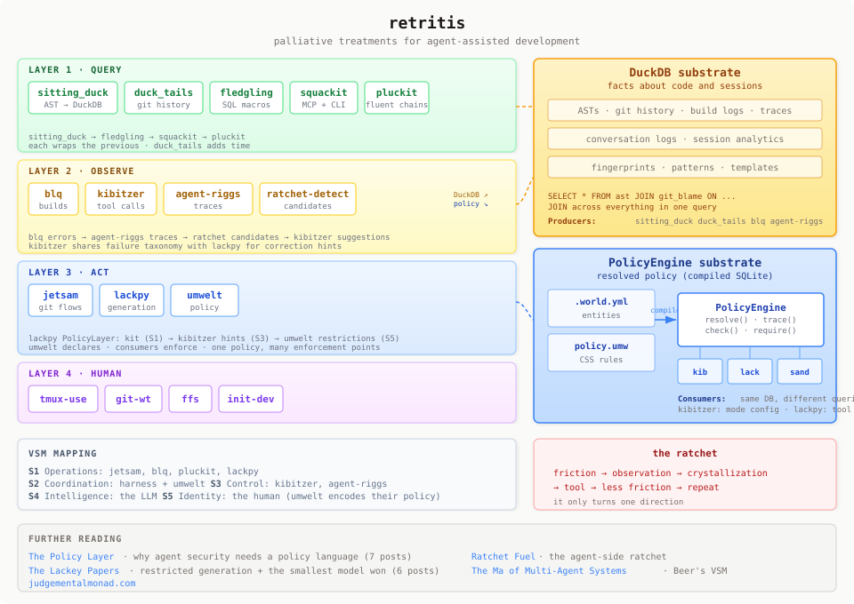

# Retritis

*Retritis* (n.): inflammation caused by repeated retries. A chronic condition of agent-assisted development. No known cure — only palliative treatments.

The retritis suite is a set of MCP servers and DuckDB extensions for coding agents.
It gives an agent typed, indexed tools for code, builds, git and memory, so it does not
have to drive everything through a raw shell.
It works with Claude Code and with any other MCP client.

[Install the suite](install) · [Read the field guide](book/index) · [See every tool](tools)

## Diagnosis

You have retritis if:

- You've copy-pasted terminal output into a chat window more than twice today
- You've typed `git add . && git commit -m "wip" && git push` from muscle memory while an agent watches
- You've explained the same codebase structure to three different Claude sessions
- You've lost work to a session crash and reconstructed it by hand
- You've written a bash script to avoid writing a bash script

## Treatment

Each tool treats one symptom.

| Symptom | Treatment | What it does |
|---|---|---|
| Pasting build output into the chat | [blq](https://blq-cli.readthedocs.io) | Runs builds and tests, keeps the output, and lets the agent query the errors later. |
| `git add . && git commit` by reflex | [jetsam](https://jetsam-mcp.readthedocs.io) | Save, sync and ship as single steps. Each step shows a plan that you confirm first. |
| Explaining the codebase again | [fledgling](https://teaguesterling.github.io/fledgling/) and [squackit](https://squackit.readthedocs.io) | Code as queryable data: definitions, callers, structure and history, from an AST index. |
| Context lost between sessions | [agent-riggs](https://agent-riggs.readthedocs.io) | Memory across sessions: briefings, recurring patterns and trust scores. |
| A bash script to avoid a bash script | [kibitzer](https://kibitzer.readthedocs.io) | Watches the agent's tool calls and suggests the structured tool instead of the shell. |
| Repeating small multi-step chores | [lackpy](https://lackpy.readthedocs.io) | Turns a plain request into a small, checked program and runs it on a local model. |

## How it fits together



The suite has two shared substrates, and you can query both with SQL.
[DuckDB](https://duckdb.org) stores facts about code, builds and sessions.
[SQLite](https://sqlite.org) stores resolved policy, compiled by
[umwelt](https://github.com/teaguesterling/umwelt). Tools share data through these
files. They do not need a server between them.

## The ratchet

Each tool in this suite addresses a specific symptom. None of them came from a plan. They came from the moment where you think "I've done this enough times." Friction produces signal. Signal crystallizes into a tool. The tool reduces friction. New friction appears at a higher level. Repeat.

This is the ratchet. It only turns one direction.

## What it saves

Measured 2026-05-25 on longbottom, Teague's build machine, against `grep` for the same questions:

| Question type | Tool | Context cost compared to grep |
|---|---|---|
| Find a definition or name (AST query) | squackit `find` / `find_names` | 96–99% fewer tokens, under one second |
| Search by text (BM25 index) | squackit search | 73–82% fewer tokens, about 10–20 ms after a one-time 2 s index build |

These numbers are from May 2026. The tools have changed since then.

```{toctree}
:hidden:
:maxdepth: 2

install
tools
book/index
```
